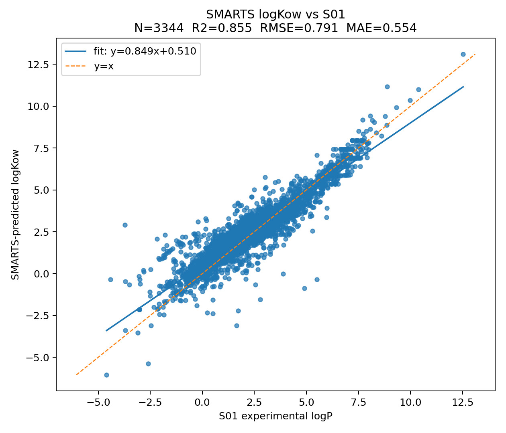
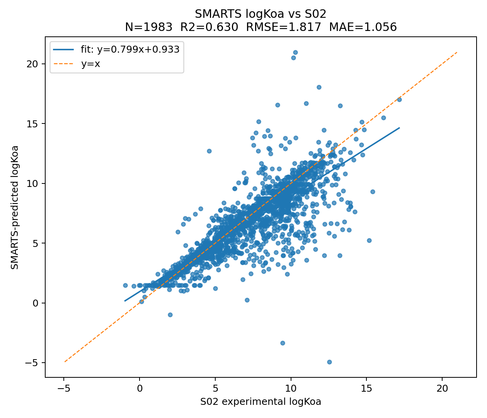
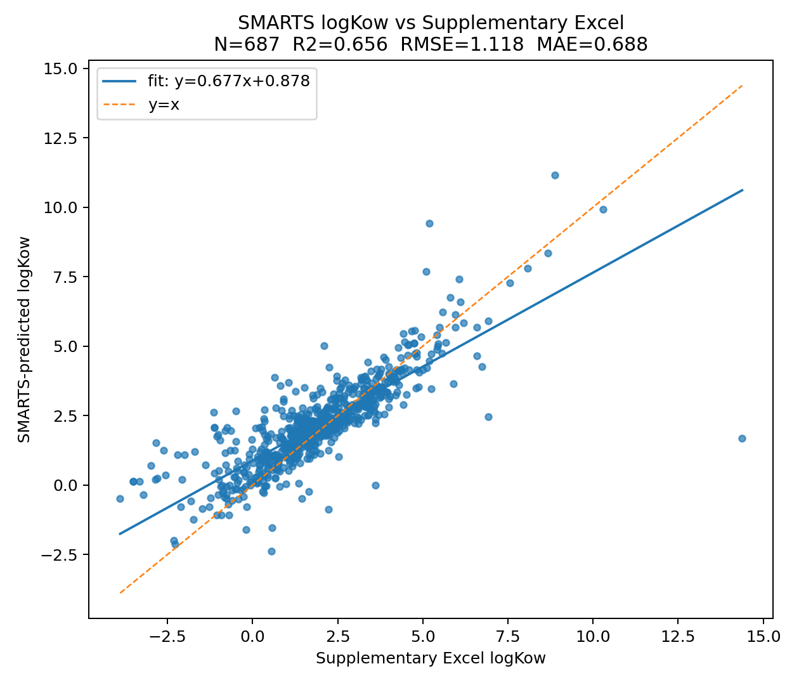

# Kawow (under development)

[](https://github.com/LucMiaz/kawow/actions/workflows/ci.yml)
[](https://www.python.org/)
[](https://github.com/LucMiaz/kawow/blob/main/LICENSE)


Prediction of **log*K*ow**, **log*K*oa** and **log*K*aw** from molecular structure.

*Kawow* implements several models for these partition coefficients: the Naef & Acree (2024) group-additivity scheme (RDKit SMARTS matching, published parameters), ridge regressions on Crippen atom types and Naef & Acree group counts, and models adding Molecular Quantum Graph (MQG) or PFASGroups descriptors. `run_models()` also classifies every prediction against regulatory bioaccumulation (B/vB) and mobility (M/vM) criteria.

---

## Installation

```bash
pip install kawow
```

Or from source (Python ≥ 3.10, RDKit ≥ 2022.9):

```bash
git clone https://github.com/LucMiaz/kawow.git
cd kawow
pip install -e ".[dev]"
```

The XGBoost and neural-network models need `pip install "kawow[ml]"`; the `mqg`, `naef_mqg` and `crippen_mqg` models need the `molecular_quantum_graph` package.

---

## Quick start

```python
import kawow

results = kawow.run_models(
    ["CCCCO", "c1ccccc1", "OC(=O)c1ccccc1"],
    models=["crippen", "naef_crippen"],
)
for row in results:
    r = row["models"]["naef_crippen"]
    print(row["smiles"], r["logKow"], r["logKoa"], r["b_class"], r["m_class"], r["in_gap"])
```

`run_models()` returns one `dict` per molecule with `name`, `smiles`, `ok` (at least one model succeeded) and `models`, a `dict` keyed by model name. Each model entry contains:

| Key | Description |
|-----|-------------|
| `status`, `ok`, `error` | outcome of the prediction (`error` only on failure) |
| `logKow`, `logKoa`, `logKaw` | predicted partition coefficients |
| `is_B`, `is_vB`, `b_class` | bioaccumulation (Kelly et al. 2007 criterion) |
| `is_B_aquatic`, `is_vB_aquatic` | bioaccumulation through the aquatic (BCF) route |
| `is_M`, `is_vM`, `is_M_potential`, `m_class` | mobility |
| `region` | `"vB"`, `"B"`, `"vM"`, `"M"` or `"neither"` |
| `in_gap`, `in_gap1`, `in_gap2`, `in_gap3`, `in_gap_bm`, `gap_labels` | regulatory gaps (see below) |
| `criteria`, `thresholds` | criteria preset and threshold values used |

### Classification criteria

**Bioaccumulation**, air-breathing organisms (Kelly et al. 2007, [doi:10.1126/science.1138275](https://doi.org/10.1126/science.1138275)):

| Flag | Condition |
|------|-----------|
| `B`  | `logKoa ≥ 6` **and** `logKow ≥ 2` |
| `vB` | `logKoa ≥ 6` **and** `logKow ≥ 5` |

**Aquatic bioaccumulation** (`is_B_aquatic`, `is_vB_aquatic`), from BCF ≈ 0.05·Kow (Mackay et al. 2013): B at `logKow > 4.6` (BCF > 2 000), vB at `logKow > 5.0` (BCF > 5 000).

**Mobility** is defined on log*K*oc and applied through a log*K*ow screening proxy. Two presets are available through the `criteria` argument (`"uba"` by default), defined in [`kawow/criteria.py`](https://github.com/LucMiaz/kawow/blob/main/kawow/criteria.py):

| Preset | M (log*K*oc) | vM (log*K*oc) | M (log*K*ow) | Potential M/vM (log*K*ow) | vM (log*K*ow) |
|--------|-------------|---------------|--------------|---------------------------|---------------|
| `uba` (Neumann & Schliebner 2019; Arp & Hale 2019 screening zones) | < 4.0 | < 3.0 | ≤ 4.5 | 3.5–4.5 | ≤ 2.5 |
| `clp` (Delegated Regulation (EU) 2023/707) | < 3.0 | < 2.0 | ≤ 3.5 | 2.5–3.5 | ≤ 1.5 |

The CLP log*K*ow cutoffs are the Arp & Hale zones shifted by the same 1.0 log-unit as the log*K*oc cutoffs. Single thresholds can be changed:

```python
results = kawow.run_models("CCCCCC", criteria="clp")
custom = kawow.get_criteria("clp", vm_logkow_threshold=2.5)   # e.g. Koc ≈ 0.35·Kow for vM
results = kawow.run_models("CCCCCC", criteria=custom)
```

**Regulatory gaps**:

| Key | Condition |
|-----|-----------|
| `in_gap` (= `in_gap3`, `in_gap_bm`) | neither M nor B by either route: `logKow` above the M cutoff and below the aquatic B cutoff (≈ 4.6), with `logKoa < 6` |
| `in_gap1` | `logKow` between the vM cutoff and 5.0 (neither vM nor vB) |
| `in_gap2` | `logKow` above the M cutoff and `logKoa < 6` |
| `gap_labels` | list of the gaps that apply (`"Gap 1"` to `"Gap 3"`) |

---

## Models

| Model key | Class | Approach | log*K*ow R² | log*K*oa R² | log*K*aw R² |
|-----------|-------|----------|-------------|-------------|-------------|
| `crippen` | `PartitionCalculator` | Ridge regression on Crippen atom types + special groups | 0.898 | 0.937 | — |
| `naef` | `NaefAcreePartitionCalculator` | Naef & Acree (2024) group additivity, published parameters (no fitting) | 0.857 | 0.777 | 0.654 |
| `naef_crippen` | `NaefAcreeCrippenPartitionCalculator` | Ridge regression on Naef & Acree group counts + Crippen atom types | 0.938 | 0.943 | 0.912 |
| `mqg` | `MQGPartitionCalculator` | Ridge regression on Naef & Acree + Crippen + MQG fingerprints | 0.940 | 0.941 | 0.913 |
| `naef_mqg`, `crippen_mqg` | `EnsemblePartitionCalculator` | Ridge regression on MQG fingerprints + Naef & Acree or Crippen features | — | — | — |
| `pfasgroups` | `PFASGroupsPartitionCalculator` | Ridge regression on PFASGroups descriptors | 0.785 | 0.896 | — |
| `pfasgroups_crippen` | `PFASGroupsPartitionCalculator` | PFASGroups + Crippen | 0.911 | 0.941 | — |
| `pfasgroups_naef` | `PFASGroupsPartitionCalculator` | PFASGroups + Naef & Acree | 0.940 | 0.939 | — |
| `pfasgroups_naef_crippen` | `PFASGroupsPartitionCalculator` | PFASGroups + Naef & Acree + Crippen | 0.943 | 0.943 | — |
| `pfasgroups_naef_crippen_rf` | `PFASGroupsRFPartitionCalculator` | Random Forest (300 trees), same features | 0.909 | 0.926 | — |
| `pfasgroups_naef_crippen_xgb` | `PFASGroupsXGBPartitionCalculator` | XGBoost (early stopping), same features; needs `kawow[ml]` | 0.936 | 0.941 | — |
| `pfasgroups_naef_crippen_nn` | `PFASGroupsNNPartitionCalculator` | Keras MLP [256-128-64], same features; needs `kawow[ml]` | 0.946 | 0.940 | — |

log*K*ow and log*K*oa R² are from 5-fold cross-validation with shared folds on the common evaluation set of the Naef & Acree datasets (n = 3 319 for log*K*ow, S01; n = 1 956 for log*K*oa, S02), from [`tests/out/shared_fold_benchmark.csv`](https://github.com/LucMiaz/kawow/blob/main/tests/out/shared_fold_benchmark.csv) (`scripts/shared_fold_benchmark.py`). `naef` uses the published parameters and is evaluated on the same molecules without fitting. log*K*aw R² is an external validation on the Naef & Acree S03 dataset (n = 2 130–2 150), which was not used for training. The old keys `naefacree` and `naefacree_mixed` still work and map to `naef` and `naef_crippen`.

The Random Forest and XGBoost models of the manuscript (trained on Naef & Acree + Crippen features only) are part of the benchmark ([`scripts/benchmark_5model.py`](https://github.com/LucMiaz/kawow/blob/main/scripts/benchmark_5model.py)) and are not available through `run_models()`.

### Benchmark of the five manuscript models

5-fold cross-validation on the common evaluation set, from [`tests/out/benchmark_metrics_5model.csv`](https://github.com/LucMiaz/kawow/blob/main/tests/out/benchmark_metrics_5model.csv) (`scripts/benchmark_5model.py`). AUC, AP (average precision), balanced accuracy and MCC classify `logKow ≥ 4.6` (aquatic B) and `logKoa ≥ 6` (B).

| Model | Endpoint | R² | RMSE | AUC | AP | Bal. Acc. | MCC |
|-------|----------|----|------|-----|----|-----------|-----|
| Crippen | log*K*ow | 0.898 | 0.663 | 0.992 | 0.961 | 0.913 | 0.863 |
| Naef & Acree | log*K*ow | 0.857 | 0.785 | 0.987 | 0.956 | 0.934 | 0.873 |
| Crippen + Naef & Acree | log*K*ow | 0.938 | 0.518 | 0.996 | 0.973 | 0.933 | 0.890 |
| Random Forest | log*K*ow | 0.916 | 0.604 | 0.990 | 0.962 | 0.913 | 0.882 |
| XGBoost | log*K*ow | 0.944 | 0.491 | 0.995 | 0.975 | 0.937 | 0.886 |
| Crippen | log*K*oa | 0.937 | 0.737 | 0.990 | 0.994 | 0.944 | 0.888 |
| Naef & Acree | log*K*oa | 0.777 | 1.387 | 0.974 | 0.985 | 0.932 | 0.860 |
| Crippen + Naef & Acree | log*K*oa | 0.943 | 0.702 | 0.990 | 0.994 | 0.946 | 0.893 |
| Random Forest | log*K*oa | 0.911 | 0.874 | 0.988 | 0.993 | 0.944 | 0.886 |
| XGBoost | log*K*oa | 0.934 | 0.753 | 0.991 | 0.995 | 0.950 | 0.898 |

---

## `PartitionCalculator`

Ridge regression on Crippen atom types and special groups, fitted on the Naef & Acree datasets. Coefficients are stored in `kawow/data/*.json`, so nothing is fitted at import time.

```python
from kawow import PartitionCalculator

calc = PartitionCalculator()

calc.predict("CCCCO")    # 1-butanol
# {'logKow': 1.095, 'logKoa': 4.368, 'logKaw': -3.273, 'status': 'ok', 'name': 'CCCCO', 'smiles': 'CCCCO'}

for r in calc.predict_batch(["c1ccccc1", "CCCCCCCCCC", "OC(=O)c1ccccc1"]):
    print(r["smiles"], r["logKow"], r["logKoa"], r["logKaw"])
```

`predict()` also accepts InChI strings, RDKit molecules, SDF files, lists and multi-line SMILES blocks (`SMILES name` per line); it returns a list for multiple molecules and skips inputs that cannot be parsed.

```python
calc.model_info["logKow"]
# {'target': 'logKow', 'n_train': 3234, 'alpha': 51.79, 'r2_cv': 0.898, 'rmse_cv': 0.6643,
#  'intercept': 0.399, ...}  (plus the fitted coefficients)
```

Re-fit on your own data (overwrites the JSON files in the package directory):

```python
import kawow
kawow.fit(sdf_logkow="my_logkow.sdf", sdf_logkoa="my_logkoa.sdf",
          logkow_prop="logP", logkoa_prop="logKoa")
calc = kawow.PartitionCalculator()   # reload after fitting
```

---

## `NaefAcreePartitionCalculator`

Implements the Naef & Acree (2024) method: each SMARTS pattern of the paper's supplementary tables is matched against the molecule and its tabulated contribution is added, so every contribution is directly interpretable.

```python
from kawow import NaefAcreePartitionCalculator

calc = NaefAcreePartitionCalculator()
calc.predict("c1ccccc1")
# {'logKow': 2.35, 'logKoa': 3.14, 'logKaw': -0.79, 'in_coverage': True}

batch = NaefAcreePartitionCalculator(smiles=["c1ccccc1", "CCCCCCCCCC", "OC(=O)c1ccccc1"])
for mol, coeffs in batch.results.items():
    print(coeffs)
```

| Dataset | Property | n | R² | RMSE |
|---------|----------|---|-----|------|
| S01 (full) | log*K*ow | 3 344 | 0.857 | 0.786 |
| S02 (full) | log*K*oa | 1 983 | 0.785 | 1.387 |
| S03 (full) | log*K*aw | 2 150 | 0.654 | 1.758 |
| Common evaluation set | log*K*ow | 3 319 | 0.857 | 0.785 |
| Common evaluation set | log*K*oa | 1 956 | 0.777 | 1.387 |

The remaining error is concentrated in specific chemotypes, notably heteroatom-rich agrochemical scaffolds.

| log*K*ow vs Naef S01 | log*K*oa vs Naef S02 | log*K*ow vs Arp & Hale |
|:--------------------:|:--------------------:|:----------------------:|
|  |  |  |

---

## Features

The Crippen feature vector (`compute_features`) has 78 entries: counts of the 72 Crippen atom types of RDKit's `Crippen.txt` (first-match priority, SMARTS only; RDKit's logP contributions are not used) and six special groups following Naef & Acree (2024): intramolecular H-bond donor/acceptor pairs within five bonds, carbon count of pure saturated hydrocarbons, carbon count of pure unsaturated acyclic hydrocarbons, carboxylic-acid groups beyond the first, hydroxyl groups beyond the first, and endocyclic C–C single bonds. See [docs/features.md](https://github.com/LucMiaz/kawow/blob/main/docs/features.md), which also describes the PFASGroups descriptors.

### Additional metrics

The benchmark also reports Lin's concordance correlation coefficient (CCC; Lin 1989), the RMSE normalised by the standard deviation and by the range of the data, and a BIC-approximated Bayes factor for a non-zero correlation (Ly et al. 2015), in [`tests/out/shared_fold_benchmark.csv`](https://github.com/LucMiaz/kawow/blob/main/tests/out/shared_fold_benchmark.csv). The functions are in `kawow.metrics`.

<!-- METRICS_DATA_BEGIN -->

| Model | Property | n | CCC | NRMSE (σ) | NRMSE (range) | log₁₀(BF₁₀) |
|-------|----------|---|-----|-----------|---------------|-------------|
| Crippen | logKow | 3319 | 0.946 | 0.319 | 0.039 | >10^300 |
| Crippen | logKoa | 1956 | 0.968 | 0.252 | 0.043 | >10^300 |
| NaefAcree | logKow | 3319 | 0.925 | 0.378 | 0.046 | >10^300 |
| NaefAcree | logKoa | 1956 | 0.894 | 0.472 | 0.082 | >10^300 |
| NaefAcree + Crippen | logKow | 3319 | 0.968 | 0.249 | 0.030 | >10^300 |
| NaefAcree + Crippen | logKoa | 1956 | 0.971 | 0.239 | 0.041 | >10^300 |
| MQG alone | logKow | 3319 | 0.483 | 0.817 | 0.099 | >10^300 |
| MQG alone | logKoa | 1956 | 0.783 | 0.594 | 0.102 | >10^300 |
| MQG + NaefAcree + Crippen | logKow | 3319 | 0.969 | 0.245 | 0.030 | >10^300 |
| MQG + NaefAcree + Crippen | logKoa | 1956 | 0.970 | 0.242 | 0.042 | >10^300 |
| PFASGroups | logKow | 3319 | 0.880 | 0.464 | 0.056 | >10^300 |
| PFASGroups | logKoa | 1956 | 0.945 | 0.322 | 0.056 | >10^300 |
| PFASGroups + Crippen | logKow | 3319 | 0.954 | 0.298 | 0.036 | >10^300 |
| PFASGroups + Crippen | logKoa | 1956 | 0.970 | 0.242 | 0.042 | >10^300 |
| PFASGroups + NaefAcree | logKow | 3319 | 0.969 | 0.246 | 0.030 | >10^300 |
| PFASGroups + NaefAcree | logKoa | 1956 | 0.968 | 0.247 | 0.043 | >10^300 |
| PFASGroups + NaefAcree + Crippen | logKow | 3319 | 0.970 | 0.240 | 0.029 | >10^300 |
| PFASGroups + NaefAcree + Crippen | logKoa | 1956 | 0.970 | 0.239 | 0.041 | >10^300 |
| PFASGroups + NaefAcree + Crippen (RF) | logKow | 3319 | 0.953 | 0.303 | — | >10^300 |
| PFASGroups + NaefAcree + Crippen (RF) | logKoa | 1956 | 0.962 | 0.273 | — | >10^300 |
| PFASGroups + NaefAcree + Crippen (XGB) | logKow | 3319 | 0.968 | 0.254 | — | >10^300 |
| PFASGroups + NaefAcree + Crippen (XGB) | logKoa | 1956 | 0.970 | 0.244 | — | >10^300 |
| PFASGroups + NaefAcree + Crippen (NN) | logKow | 3319 | — | — | — | >10^300 |
| PFASGroups + NaefAcree + Crippen (NN) | logKoa | 1956 | — | — | — | >10^300 |

<!-- METRICS_DATA_END -->

### Y-randomisation

`python scripts/shared_fold_benchmark.py --y-randomization` permutes the target values (1 000 permutations by default, `--y-rand-permutations`) for the trainable models of the shared-fold benchmark and writes `tests/out/y_randomization.csv`. A model captures a genuine structure–property relationship when its observed R² lies far above the permuted values, that is when the p-value (fraction of permuted R² ≥ observed R²) is close to zero. The y-randomisation reported in the manuscript (Crippen and Crippen + Naef & Acree, 300 permutations) is produced by [`manuscript/yrandomization.py`](https://github.com/LucMiaz/kawow/blob/main/manuscript/yrandomization.py).

---

## Manuscript

The [`manuscript/`](https://github.com/LucMiaz/kawow/tree/main/manuscript) folder contains the scripts that reproduce the figures and SI tables of *A Vanishing Partitioning Gap* (Miaz & Cousins); see [`manuscript/README.md`](https://github.com/LucMiaz/kawow/blob/main/manuscript/README.md).

---

## References

Naef, R.; Acree, W. E. Calculation of the Three Partition Coefficients logPow, logKoa and logKaw of Organic Molecules at Standard Conditions at Once by Means of a Generally Applicable Group-Additivity Method. *Liquids* **2024**, 4 (1), 231–260. [doi:10.3390/liquids4010011](https://doi.org/10.3390/liquids4010011)

Kelly, B. C.; Ikonomou, M. G.; Blair, J. D.; Morin, A. E.; Gobas, F. A. P. C. Food Web–Specific Biomagnification of Persistent Organic Pollutants. *Science* **2007**, 317 (5835), 236–239. [doi:10.1126/science.1138275](https://doi.org/10.1126/science.1138275)

Mackay, D.; Arnot, J. A.; Gobas, F. A. P. C.; Powell, D. E. Mathematical Relationships between Metrics of Chemical Bioaccumulation in Fish. *Environ. Toxicol. Chem.* **2013**, 32 (7), 1459–1466. [doi:10.1002/etc.2205](https://doi.org/10.1002/etc.2205)

Neumann, M.; Schliebner, I. *Protecting the Sources of Our Drinking Water: The Criteria for Identifying PMT and vPvM Substances under EU Regulation REACH*; TEXTE 127/2019; German Environment Agency (UBA), 2019.

Arp, H. P. H.; Hale, S. E. *REACH: Improvement of Guidance and Methods for the Identification and Assessment of PMT/vPvM Substances*; TEXTE 126/2019; German Environment Agency (UBA), 2019.

Arp, H. P. H.; Hale, S. E. Assessing the Persistence and Mobility of Organic Substances to Protect Freshwater Resources. *ACS Environ. Au* **2022**, 2 (6), 482–509. [doi:10.1021/acsenvironau.2c00024](https://doi.org/10.1021/acsenvironau.2c00024) (supplementary data `vg2c00024_si_001`)

Commission Delegated Regulation (EU) 2023/707 amending Regulation (EC) No 1272/2008 as regards hazard classes and criteria for the classification, labelling and packaging of substances and mixtures. [ELI](http://data.europa.eu/eli/reg_del/2023/707/oj)

Lin, L. I.-K. A Concordance Correlation Coefficient to Evaluate Reproducibility. *Biometrics* **1989**, 45, 255–268. [doi:10.2307/2532051](https://doi.org/10.2307/2532051)

Ly, A.; Verhagen, A. J.; Wagenmakers, E.-J. Harold Jeffreys's Default Bayes Factor Hypothesis Tests. *J. Math. Psychol.* **2016**, 72, 19–32. [doi:10.1016/j.jmp.2015.06.004](https://doi.org/10.1016/j.jmp.2015.06.004)

Steiger, J. H. Tests for Comparing Elements of a Correlation Matrix. *Psychol. Bull.* **1980**, 87, 245–251. [doi:10.1037/0033-2909.87.2.245](https://doi.org/10.1037/0033-2909.87.2.245)

Chicco, D.; Tötsch, N.; Jurman, G. The Matthews Correlation Coefficient (MCC) Is More Reliable Than Balanced Accuracy. *BioData Mining* **2021**, 14, 13. [doi:10.1186/s13040-021-00244-z](https://doi.org/10.1186/s13040-021-00244-z)

## License

[CC BY 4.0](https://creativecommons.org/licenses/by/4.0/) — Luc T. Miaz, 2026
